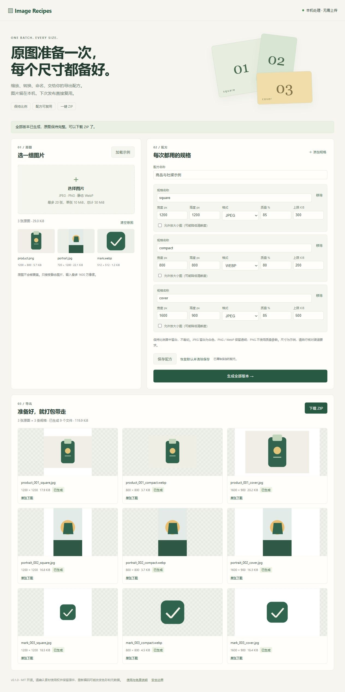

# Image Recipes

**One batch. Every size.**

选一组图片，按可复用的配方生成多种尺寸、格式和统一文件名，一次下载 ZIP。面向商家、设计师、内容运营，也可把纯模块复用于其他图片导出界面。

素材在本机浏览器处理，不上传、不覆盖原图；只保存导出配方。原生 JavaScript + Canvas，零第三方运行依赖，MIT 开源。



## 快速开始

需要 Node.js **22+**，以及支持 `createImageBitmap`、Canvas JPEG/PNG/WebP 编码的近期桌面浏览器。实际验证环境见下文。

```sh
git clone https://github.com/tom090tom/image-recipes.git
cd image-recipes
npm start
```

打开 <http://127.0.0.1:4174>，点击 **加载示例 → 生成全部版本 → 下载 ZIP**。无需 `npm install`。端口占用时使用 `npm start -- --port 4175`。

内置 3 张合成图片 × 3 条示例规格，产生 9 个文件：

| 规格 | 画布尺寸 | 格式 | 质量 | 大小提示阈值 |
| --- | --- | --- | --- | --- |
| square | 1200 × 1200 | JPEG | 85% | 300 KiB |
| compact | 800 × 800 | WebP | 80% | 200 KiB |
| cover | 1600 × 900 | JPEG | 85% | 500 KiB |

这些是演示规格，不代表任何平台的官方要求。使用自己的图片：选择素材 → 修改规格 → 生成 → 检查结果 → 下载。点击“保存配方”后，刷新或下次打开时复用；“恢复默认并清除保存”删除保存的设置。图片和导出文件不会持久保存。

## 处理规则与边界

- **输入：** JPEG、PNG、静态 WebP；按实际文件内容识别，不依赖扩展名。拒绝 SVG、GIF、APNG、动画 WebP；不处理动图、视频或 RAW。
- **缩放：** 保持比例、居中留白、不裁切；默认不放大。勾选放大选项会放大小图，可能模糊。输出画布始终为设定尺寸，JPEG 背景为白色，PNG/WebP 保留透明。
- **编码：** JPEG/WebP 使用质量参数；PNG 忽略该参数。浏览器不支持目标编码时明确报错，不把降级 PNG 伪装成 WebP。不同浏览器的大小、色彩和质量可能不同。
- **大小：** 上限以 KiB（1024 字节）表示，0 表示不检查。超限会标记，仍可下载；不自动裁切或不断降质以硬凑大小，也不保证一次编码达标。
- **规模：** 每批最多 20 张、单张 10 MiB、合计 50 MiB；输入/输出最多 1600 万像素，输出单边 16–4096；最多 5 条规格，成功文件合计最多 100 MiB。打包与预览额外占用内存，低内存设备请拆批。
- **失败：** 不支持的输入在原图区列出；解码/编码失败在导出区列出。成功结果保留，ZIP 只包含成功图片；有失败或超限时应人工检查，不能把部分完成当作全部达标。
- **命名：** `原图序号_原名_规格名.扩展名`，固定序号前缀避免同名或名称组合冲突；过滤路径、控制字符和系统保留名，保留可用中文。ZIP 使用 UTF-8 STORE 格式，图片已压缩，无需重复压缩。
- **色彩与隐私：** 重新编码会改变元数据与可能的色彩/画质，不适合要求原始 EXIF、ICC 或印刷色彩精确保真的流程。图片中可见的私人信息不会自动脱敏。请保留原件和素材授权。

## 开发与复用

```sh
npm test
npm run check
```

| 文件 | 职责 |
| --- | --- |
| `src/recipes.js` | 规格校验、比例缩放坐标、安全命名与批次限制 |
| `src/image-info.js` | 图片类型、尺寸与动画头检查 |
| `src/zip.js` | UTF-8 ZIP STORE 导出，拒绝不安全/重复名称 |
| `web/processor.js` | 浏览器实际解码、Canvas 编码、顺序处理与释放资源 |
| `web/app.js` | 配方编辑、保存、预览和下载 |
| `bin/server.js` | 回环地址、固定资源的本地服务 |

```js
import { DEFAULT_RECIPE, fitImage } from './src/recipes.js';
import { createZip } from './src/zip.js';

const placement = fitImage(1200, 800, DEFAULT_RECIPE.variants[1]);
// { width: 800, height: 533, x: 0, y: 133 }：绘制到 800 × 800 画布。
const archive = createZip([{ name: 'example.txt', data: new TextEncoder().encode('hello') }]);
// Uint8Array；图片处理模块需要浏览器环境，首版无图片处理 CLI。
```

本地验证：Windows / Node.js 24.20.0，37 项自动测试与语法检查通过；实际浏览器验证示例、9 个结果、ZIP、格式/尺寸、透明背景和配方保存。ZIP 另由 Python 标准库与 Pillow 解码核对 CRC、图片尺寸和格式。未验证的平台不宣称支持。

CI 暂未启用：现有推送凭据没有 GitHub `workflow` 权限。[CI 模板](docs/ci-template.yml) 可在具备权限后移至 `.github/workflows/ci.yml` 并实际运行；当前必需状态检查留空。

## 安全与开源协作

版本 `0.1.0`。请阅读 [安全边界](SECURITY.md)、[使用与免责说明](DISCLAIMER.md)、[贡献规范](CONTRIBUTING.md) 和 [CHANGELOG](CHANGELOG.md)。`package.json` 的 `private: true` 仅阻止误发布 npm，不影响 GitHub 公开或 MIT 开源。

使用 SemVer、约定式提交、短期分支与 PR 评审；发布后 `main` 要求独立审查者批准，管理员同样受保护。请勿把未经授权的客户素材、私人信息或凭据放进 Issue/PR。
